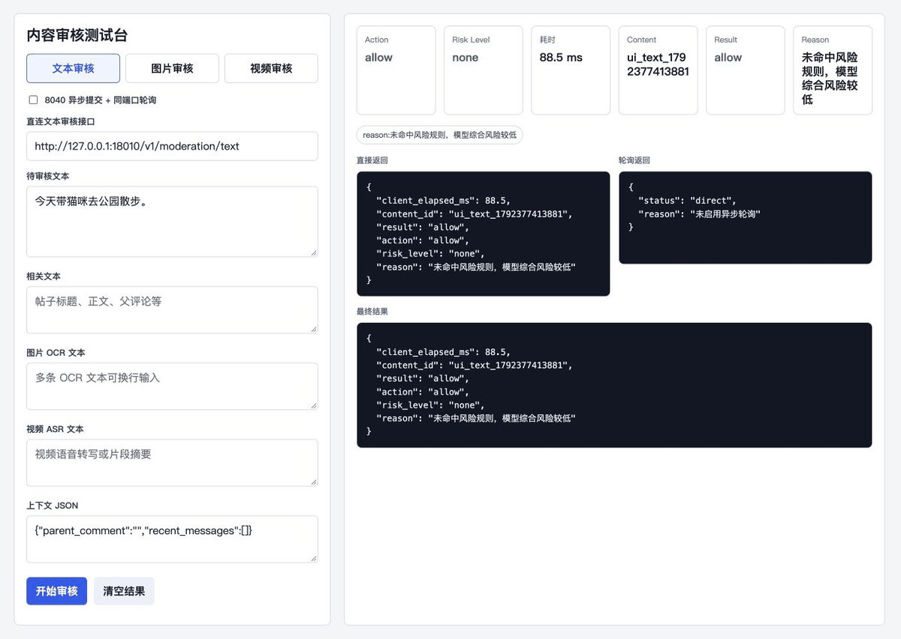
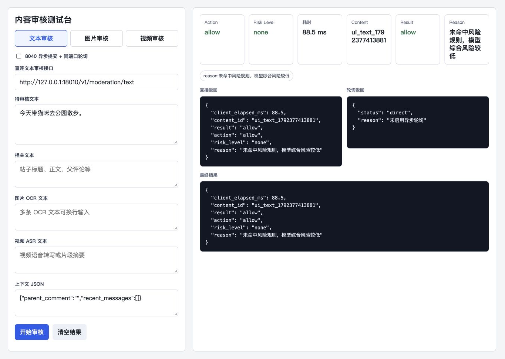
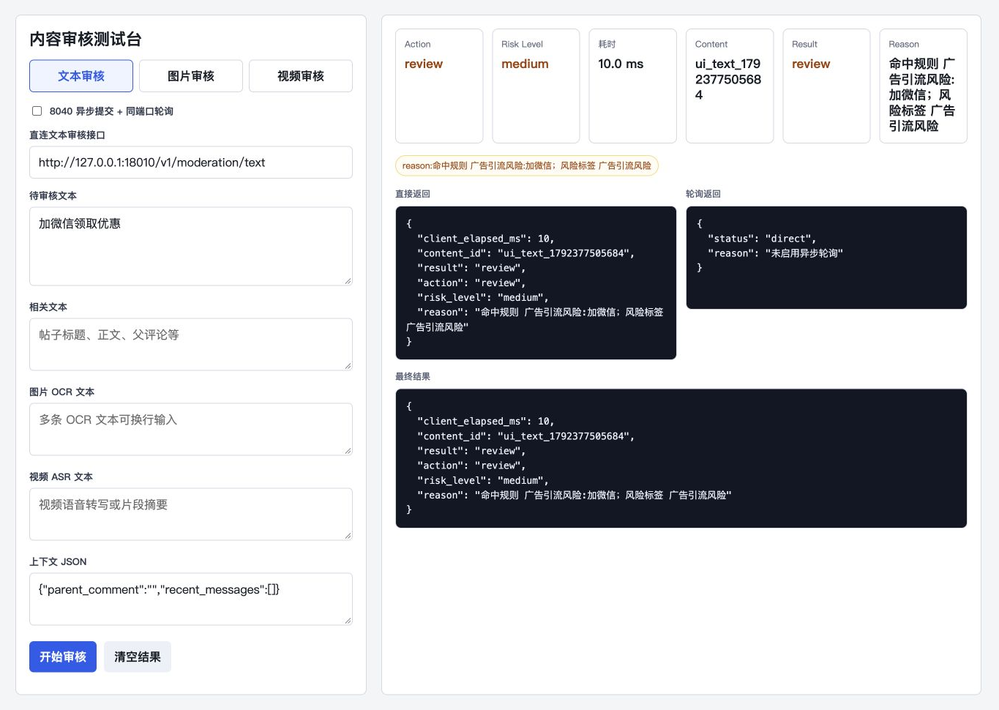

# 内容审核 · 可复现的文本规则演示



| 放行 | 转复核 |
| --- | --- |
|  |  |

截图与动图使用仓库原有 `tools/text-audit-ui/index.html` 和真实文本服务。本次使用文本规则与内置启发式判断：语义模型、分类器和 Agent 均关闭，没有调用线上审核系统或外部模型。页面显示的耗时只属于这两次本地调用，不构成性能基准；默认通用原因文案中的“模型”字样不代表模型已启用。

## 复现

在专用 Python 环境、仓库根目录执行：

```bash
python -m pip install -r services/text-audit/requirements.txt
python docs/showcase/run_text_demo.py
```

另开终端：

```bash
python tools/text-audit-ui/serve.py --host 127.0.0.1 --port 18050
```

打开 `http://127.0.0.1:18050/`，关闭异步模式，直连地址填 `http://127.0.0.1:18010/v1/moderation/text`。依次提交以下无个人信息的合成样例：

| 输入 | 本次实际返回 |
| --- | --- |
| 今天带猫咪去公园散步。 | `allow` / `none` |
| 加微信领取优惠 | `review` / `medium` |

演示脚本在临时目录中生成关闭模型的阈值配置；结束后清理，不改写原项目配置。使用 `Ctrl+C` 停止两个终端服务。

`workflow.svg` 概括完整服务拓扑；图片、视频、OCR、ASR、语义模型以及网关异步任务没有由这次文本演示验证。相关部署见 [测试台说明](../../tools/text-audit-ui/README.md)。
